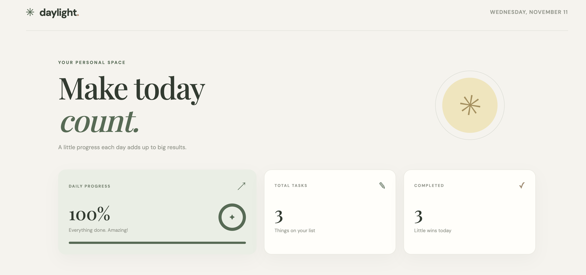
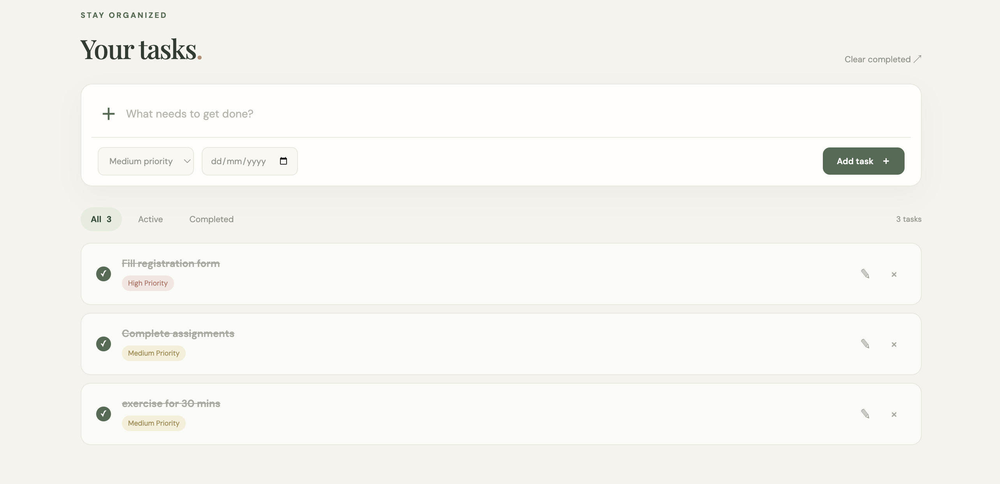

# ✳ Daylight — Aesthetic To-Do List

A beautiful, minimalist, and fully responsive To-Do List application built using HTML, CSS, and JavaScript. Daylight helps you organize daily tasks, manage priorities, track progress, and stay productive with a calm and elegant interface.

## 📸 Screenshots

### 1. Application Interface


### 2. Task Management


## ✨ Features

- **Add Tasks:** Quickly create new tasks.
- **Edit Tasks:** Update existing task details.
- **Delete Tasks:** Remove tasks you no longer need.
- **Task Completion:** Mark tasks as completed.
- **Priority Management:** Assign Low, Medium, or High priority.
- **Due Dates:** Set deadlines for individual tasks.
- **Task Filtering:** View All, Active, or Completed tasks.
- **Progress Tracking:** Monitor completion percentage through a visual progress indicator.
- **Dashboard Statistics:** View total and completed task counts.
- **Clear Completed:** Remove all completed tasks at once.
- **Local Storage:** Automatically save tasks in the browser.
- **Responsive Design:** Optimized for desktop, tablet, and mobile devices.
- **Smooth Animations:** Subtle transitions and interactive hover effects.

## 🎨 Design Highlights

- Minimalist editorial-inspired interface.
- Warm beige and cream background.
- Sage green accents.
- Soft pastel priority indicators.
- Elegant Playfair Display and DM Sans typography.
- Clean dashboard with progress visualization.
- Responsive layouts for different screen sizes.

## 🛠️ Technologies Used

| Technology | Purpose |
|---|---|
| HTML5 | Application structure |
| CSS3 | Styling, animations, and responsive design |
| JavaScript | Task management and application logic |
| Local Storage | Persistent browser-based task storage |
| Google Fonts | Typography |

## 🚀 Getting Started

### 1. Clone the Repository

```bash
git clone YOUR_REPOSITORY_URL
```

### 2. Navigate to the Project Folder

```bash
cd Aesthetic-To-Do-List
```

### 3. Run the Application

Open `index.html` in your preferred web browser.

Alternatively, use the Live Server extension in Visual Studio Code.

## 📁 Project Structure

```text
Aesthetic-To-Do-List/
│
├── screenshots/
│   ├── todo1.png
│   └── todo2.png
│
├── README.md
├── index.html
├── script.js
└── style.css
```

## 💾 Data Storage

The application uses the browser's Local Storage API to save tasks automatically. Tasks remain available after refreshing or reopening the browser on the same device and browser.

## 🌱 Future Improvements

- Task categories and custom labels.
- Search functionality.
- Dark mode.
- Calendar-based task organization.
- Notifications and reminders.

## 👩‍💻 Author

Created using HTML, CSS, and JavaScript.

---

<p align="center">
  ✳ <b>Make today count. One task at a time.</b> ✳
</p>
